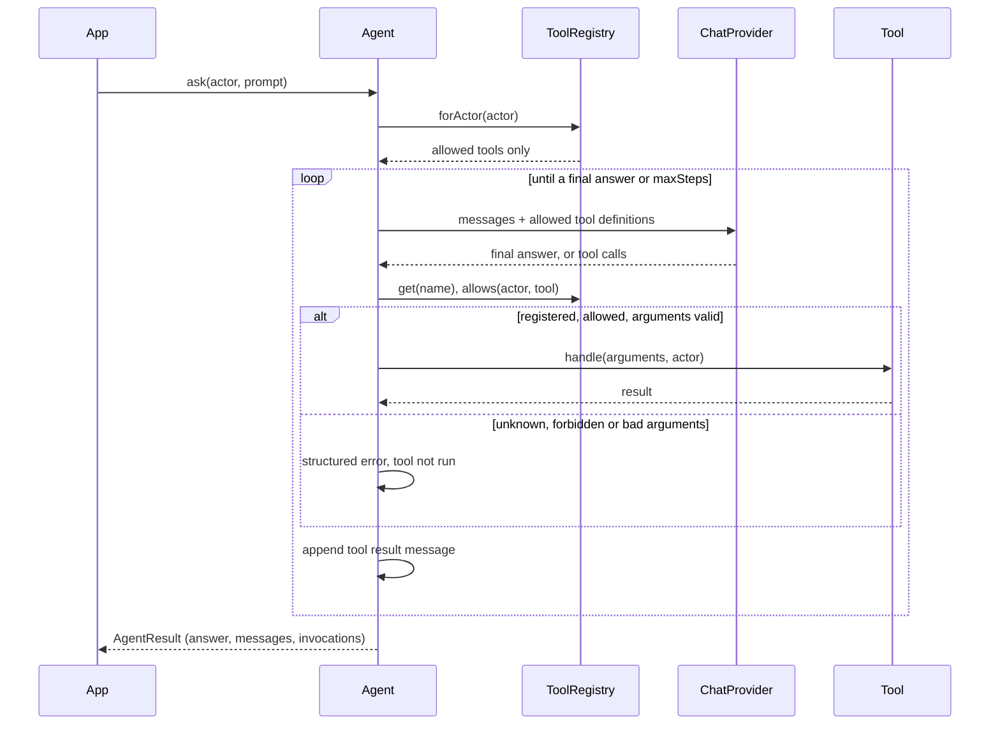

# llm-tool-calling-php

[](https://github.com/ahmed29345/llm-tool-calling-php/actions/workflows/tests.yml)


[](LICENSE)

A small, framework-agnostic PHP library for running an LLM agent loop with tool calling, where the
tools a model can see and call depend on who the user is.

It works with the OpenAI Chat Completions API, any OpenAI-compatible server (vLLM, LM Studio,
llama.cpp, gateways) and Ollama. It talks HTTP through PSR-18, so it fits into Laravel, Symfony or
plain PHP without pulling in a framework.

## Why role-scoped tools

When an assistant can call tools, the tool list is part of your security boundary. If a teacher's
assistant is given an `unpaid_invoices` tool and a prompt says "don't use it unless the user is in
finance", you are relying on the model to enforce access control. Prompt injection, a confused
model or a cleverly worded question is enough to get past that.

This library takes the decision away from the model:

1. **The model only sees tools the user may use.** `ToolRegistry::forActor()` filters tool
   definitions before they are sent, so a teacher's request never contains the finance tool at all.
2. **Every call is authorised again before it runs.** Models can and do call tools they were not
   offered (hallucinated names, names leaked from earlier context). The agent re-checks the
   permission at execution time and never trusts the model's choice.
3. **Bad calls don't crash the conversation.** Unknown tools, forbidden tools, malformed JSON
   arguments and missing required fields become a structured error the model can read and recover
   from. Unknown and forbidden tools get the same answer, so the model cannot probe for privileged
   tools, while your audit log still records which it was.

## Install

Requires PHP 8.2+ and any PSR-18 HTTP client with PSR-17 factories (Guzzle shown here).

```bash
composer config repositories.llm-tool-calling vcs https://github.com/ahmed29345/llm-tool-calling-php
composer require ahmed29345/llm-tool-calling:dev-main guzzlehttp/guzzle
```

## Usage

```php
use Ahmed29345\LlmToolCalling\{Actor, Agent, CallableTool, ToolRegistry};
use Ahmed29345\LlmToolCalling\Provider\OpenAiProvider;
use GuzzleHttp\{Client, Psr7\HttpFactory};

$tools = new ToolRegistry([
    new CallableTool(
        name: 'unpaid_invoices',
        description: 'List unpaid fee invoices, optionally for one class.',
        parameters: ['type' => 'object', 'properties' => ['class' => ['type' => 'string']]],
        handler: fn (array $args, Actor $actor) => $invoices->unpaid($args['class'] ?? null),
        permission: 'finance.view',
    ),
    // ... more tools, each with its own permission (or none)
]);

$http = new HttpFactory();
$provider = new OpenAiProvider(new Client(), $http, $http, model: 'gpt-4o-mini', apiKey: getenv('OPENAI_API_KEY') ?: null);

$agent = new Agent($provider, $tools, systemPrompt: 'You are a school office assistant.', maxSteps: 6);
$result = $agent->ask(new Actor(42, ['teacher'], ['attendance.view']), 'Who still owes fees?');

echo $result->answer;         // The teacher was never offered unpaid_invoices.
$result->invocations;         // Every tool call the model asked for, with its outcome.
```

For larger tools, implement the `Tool` interface:

```php
interface Tool
{
    public function name(): string;
    public function description(): string;
    public function parameters(): array;              // JSON Schema for the arguments object
    public function requiredPermission(): ?string;    // null = any actor
    public function handle(array $arguments, Actor $actor): mixed;
}
```

`handle()` receives the actor, so a tool can also scope its *data* (a teacher sees their own
classes, a parent their own children). Throw `ToolException` for errors the model should see; any
other exception is reported to the model as a generic failure and kept on the invocation for your
logs, so SQL errors and stack traces never reach the model or the user.

### Permissions

`Actor` holds an id, roles and resolved permission strings. A permission matches exactly, `*`
matches everything, and `finance.*` matches anything under `finance.`. Resolve roles to permissions
in your own application. To use your framework's policy layer instead (Laravel Gates, Symfony
Voters), implement `Authorization\Authorizer` and pass it to `ToolRegistry`. The same authorizer
is used both for filtering and for the execution-time check.

### Providers

| Provider         | Endpoint                          | Notes                                                       |
|------------------|-----------------------------------|-------------------------------------------------------------|
| `OpenAiProvider` | `POST {baseUrl}/chat/completions` | Set `baseUrl` for any OpenAI-compatible server.             |
| `OllamaProvider` | `POST {baseUrl}/api/chat`         | Non-streaming; maps Ollama's object arguments and tool ids. |
| `FakeProvider`   | none                              | Replays scripted responses and records requests, for tests. |

Write your own by implementing `Chat\ChatProvider::chat(array $messages, array $tools): ChatResponse`.

### What the model gets back

| Situation                                      | Tool runs? | Model receives                    | `ToolOutcome`      |
|------------------------------------------------|------------|-----------------------------------|--------------------|
| Allowed tool, valid arguments                  | yes        | the result (JSON unless a string) | `Succeeded`        |
| Tool name not registered                       | no         | `tool_not_available`              | `UnknownTool`      |
| Tool exists, actor lacks permission            | no         | `tool_not_available`              | `Forbidden`        |
| Arguments not a JSON object / required missing | no         | `invalid_arguments`               | `InvalidArguments` |
| Tool throws `ToolException`                    | yes        | `tool_error` with its message     | `Failed`           |
| Tool throws anything else                      | yes        | `tool_failed`, no details         | `Failed`           |

Errors are sent as `{"error": {"code": "...", "message": "..."}}`. If the model is still calling
tools after `maxSteps` requests, the run stops with `StopReason::MaxStepsReached` and a null answer.

## Architecture



```
src/
  Agent.php                  the loop and the execution-time checks
  ToolRegistry.php           registration and per-actor filtering
  Actor.php, Tool.php        the two things you provide
  Authorization/             Authorizer interface + default permission check
  Chat/                      provider-neutral Message, ToolCall, ChatResponse, ChatProvider
  Provider/                  OpenAI, Ollama and Fake providers
```

## Example: school assistant

`examples/school-assistant.php` has three tools over in-memory data: `class_roster` (no
permission), `attendance_summary` (`attendance.view`) and `unpaid_invoices` (`finance.view`). Ask
the same question as different roles and watch the tool list change.

```bash
# No model needed: a scripted model that always tries the finance tool
LLM_PROVIDER=fake php examples/school-assistant.php teacher

# OpenAI, or any compatible server via OPENAI_BASE_URL
OPENAI_API_KEY=... php examples/school-assistant.php accountant "Who owes fees in Grade 4B?"

# Local Ollama (OLLAMA_MODEL defaults to llama3.1)
php examples/school-assistant.php principal
```

```
Actor:    teacher-7 (teacher)
Tools:    class_roster, attendance_summary
  -> attendance_summary {"class":"Grade 3A"}  [succeeded]
  -> unpaid_invoices {"class":"Grade 3A"}  [forbidden]
```

## Running tests

```bash
composer install
composer test      # PHPUnit
composer analyse   # PHPStan, level 8
```

Provider tests run against a real PSR-18 client (Guzzle) with a mocked handler, so request and
response mapping is checked without network access.

## Scope

Deliberately small: no streaming, tool calls run one after another, and argument validation only
checks the schema's `required` list. Validate argument values inside your tools.

## License

MIT. See [LICENSE](LICENSE).
